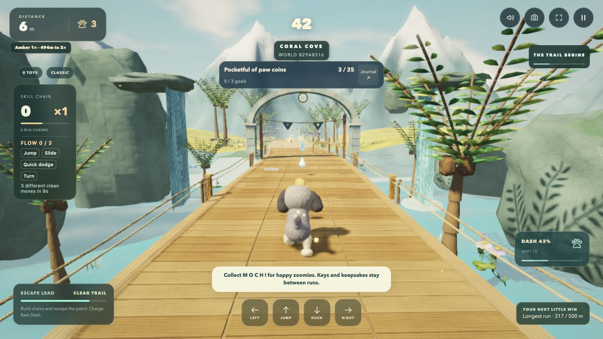
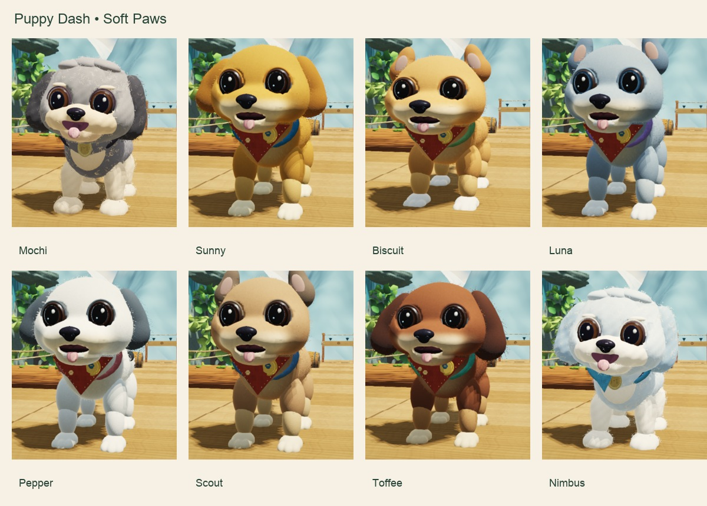
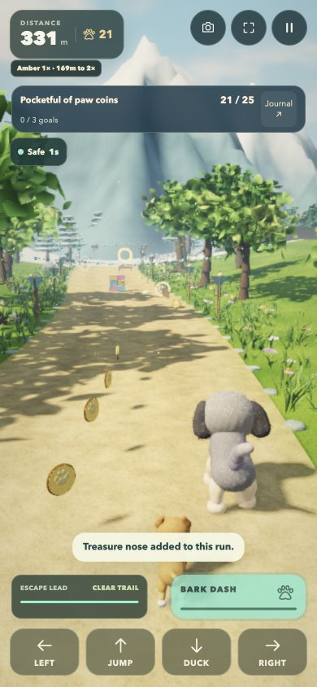

# 🐾 Puppy Dash — Open Trail

**A playful 3D puppy-running adventure, right in your browser.** Pick a trail, dodge obstacles, collect treasures, unlock rewards, and meet a whole pack of puppy friends.

### [▶ Play Puppy Dash](https://jonbiro.github.io/puppy-dash-play/)

No installation or account required to start. **A modern browser with WebGL 2 and hardware acceleration is required.**

[](https://jonbiro.github.io/puppy-dash-play/)

## What you can do

- **Choose your pace:** Adventure, Daily Trail, Chill, 90s Sprint, Practice, Journey, and Expeditions.
- **Explore new places:** Follow scenic 3D routes, choose turns, and discover different environments.
- **Learn new moves:** Jump, double-jump, duck, dodge, and charge a *Bark Dash*.
- **Collect and progress:** Gather paw coins, toys, MOCHI letters, keepsakes, and medals while tackling optional challenges.
- **Make friends:** Meet and unlock a cast of eight puppies, with outfits and other rewards to discover.
- **Keep the memories:** Visit the journey map, check your milestones, and use photo mode.

### A peek at the pack



### Portrait play



*Screenshots are from the Open Trail development build; presentation may vary slightly with browser, display, and game updates.*

## How to play

1. **[Open Puppy Dash](https://jonbiro.github.io/puppy-dash-play/)** in a recent desktop or mobile browser that supports WebGL 2.
2. On the start screen, choose a mode (start with **Adventure** or **Practice**), then select a trail.
3. Press **Let's run** to begin. Follow the path, avoid obstacles, and collect rewards.

### Controls

| Action | Keyboard | Touchscreen |
| --- | --- | --- |
| Steer left or right | **← / →** or **A / D** | **Left / Right** buttons |
| Jump | **Space** or **↑** | **Jump** |
| Double jump | Press jump again while airborne | Tap **Jump** again |
| Duck / dive | **↓** or **S** | **Duck** |
| Bark Dash | **Shift** or **X** | On-screen **Bark Dash** when available |

Controls and prompts also appear in the game. Some modes introduce additional mechanics.

## Your progress

Progress is saved **in the browser you're using**, not automatically across devices or browsers. The game offers **Export progress** and **Import progress** to help you preserve or move a save. Export before clearing browser data or changing devices.

The public version is a standalone browser build; optional account and cloud-sync services are not deployed.

## Requirements and troubleshooting

- **WebGL 2:** The game needs a browser with WebGL 2 support and hardware acceleration. Current versions of Chrome, Edge, Firefox, and Safari are worth trying, though compatibility varies by device.
- **Blank screen or “Let's find a better trail” message?** Open the game directly in a full browser instead of an embedded preview, make sure graphics acceleration is enabled, and update your browser.
- **Mobile devices:** On-screen controls are included, but real-device performance and browser compatibility can vary; physical-device testing is still ongoing.

## Run the public build locally

This repository distributes the self-contained game as `index.html` with GitHub Pages support via `.nojekyll`. You don't need a JavaScript build tool to serve it.

```bash
git clone https://github.com/jonbiro/puppy-dash-play.git
cd puppy-dash-play
python3 -m http.server 8000
```

Then open **http://localhost:8000/** in a WebGL 2-capable browser.

> **Repository scope:** This is the **playable, compiled/standalone game build**, not the full editable development source, internal test suite, or a reusable game engine. The game is actively evolving; a working public browser build does not imply every device has been validated. No separate open-source reuse license is included in this distribution.

## Feedback

Found a bug or have an idea? [Open an issue](https://github.com/jonbiro/puppy-dash-play/issues) and include the browser/device, the game mode, and steps to reproduce it. Please don't post personal information or save files containing private data.

Made by [Jonathan Biro](https://github.com/jonbiro). 🐶
